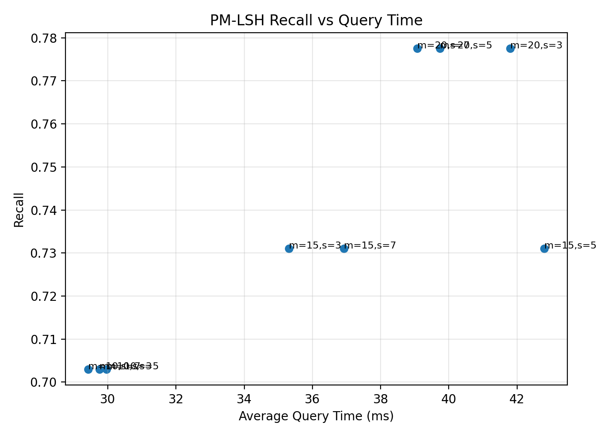

# PM-LSH in Python

A from-scratch Python reimplementation of **PM-LSH** (Zheng et al., *PM-LSH: A Fast and Accurate LSH Framework for High-Dimensional Approximate Nearest Neighbor Search*, PVLDB 2020), evaluated on MNIST.

This is **not** the authors' C++ code. It is a clean-room implementation of the paper's core ideas, written to understand the algorithm and measure its accuracy/cost trade-offs.

## What it implements

- **Gaussian random projection** from 784 dimensions down to `m` dimensions.
- **PM-tree** (`pmtree.py`): a metric index over the projected points, with ball-partition nodes, covering radii and pivot hyper-ring pruning, supporting Euclidean range queries. Every node stores its entries as NumPy arrays, so the ball filter, hyper-ring filters and leaf checks for a whole node run as one vectorized operation.
- **Chi-square confidence-interval mapping** (`pm_lsh.py`): maps an original-space radius to a projected-space radius, with `alpha2` solved in closed form from the paper's Equation 10 using `scipy.stats.chi2`.
- **(c, k)-ANN query**: range expansion in projected space, then exact reranking of the candidates in the original space.

## Results

k = 10, c = 1.5, 200 queries, seed 42. Recall is recall@10 against exact search. Overall ratio is the mean of approximate / exact neighbor distance (1.0 is perfect). Rerank fraction is the share of the dataset whose exact 784-d distance is computed.

| Indexed vectors | m | Recall@10 | Overall ratio | Rerank fraction | PM-LSH query |
|-----------------|---|-----------|---------------|-----------------|--------------|
| 15,000 | 10 | 0.703 | 1.031 | 4.6% | ~30 ms |
| 15,000 | 15 | 0.731 | 1.028 | 3.2% | ~38 ms |
| 15,000 | 20 | **0.778** | **1.021** | 2.9% | ~40 ms |
| 60,000 | 10 | 0.684 | 1.032 | 2.7% | ~84 ms |
| 60,000 | 15 | 0.742 | 1.026 | 1.7% | ~114 ms |
| 60,000 | 20 | **0.773** | **1.023** | **1.6%** | ~157 ms |

Full per-run numbers: [`pm_lsh_outputs/`](pm_lsh_outputs/) (15K) and [`pm_lsh_outputs_60k/`](pm_lsh_outputs_60k/) (60K).

### Vectorizing the PM-tree

The first version walked the tree one entry at a time in Python. Storing each node's entries as arrays and evaluating all filters for a node at once cut average query time at 15K vectors, m = 20, from **153.7 ms to 39.7 ms (3.9x)**, with identical recall (0.7775) because the pruning decisions are unchanged.

## Honest limitations

- **It is still slower than an optimized brute-force scan.** `datasets.FastBruteForce` computes exact k-NN with one BLAS matrix-vector product (`||x||^2 - 2x.q`) plus `argpartition`: about 2.6 ms at 15K and 9 ms at 60K, versus 40-160 ms for PM-LSH here. Tree traversal in Python still costs far more per node than a dense matrix product, and the projected-space search radius is wide enough that most nodes are visited. The reduction in exact distance computations would only translate into wall-clock wins with a compiled index and much larger datasets.
- **Pivot count did not change recall.** Pivots only affect pruning, not which points qualify, so recall is identical for 3, 5 and 7 pivots; only query time differs, and the differences are small and noisy.
- Only MNIST was tested.
- The "same-label accuracy" column in the CSV (fraction of queries whose top result shares the query's digit label) is a sanity check, not a standard ANN metric.

## Files

| File | Purpose |
|------|---------|
| `pmtree.py` | Vectorized PM-tree with pivot hyper-ring pruning and Euclidean range queries |
| `pm_lsh.py` | PM-LSH index: projection, confidence-interval parameters, (c, k)-ANN search |
| `datasets.py` | MNIST loader, reference brute-force k-NN, and the optimized `FastBruteForce` baseline |
| `evaluate.py` | Sweeps `m` and pivot count, times PM-LSH and both baselines separately, writes CSV/JSON/plots |

## Run

```bash
pip install -r requirements.txt
python evaluate.py --train-size 15000 --out-dir pm_lsh_outputs
python evaluate.py --train-size 60000 --out-dir pm_lsh_outputs_60k
```



