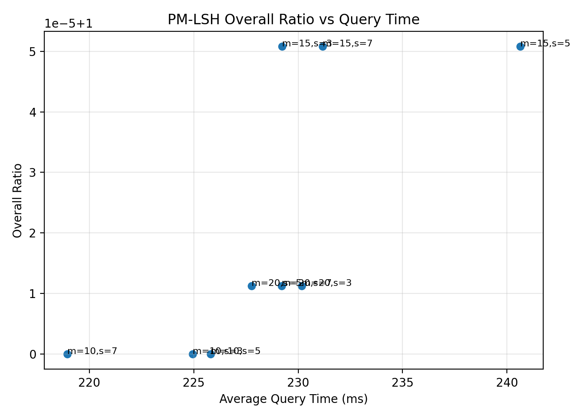

# PM-LSH in Python

A from-scratch Python reimplementation of **PM-LSH** (Zheng et al., *PM-LSH: A Fast and Accurate LSH Framework for High-Dimensional Approximate Nearest Neighbor Search*, PVLDB 2020), evaluated on MNIST.

This is **not** the authors' C++ code. It is a clean-room implementation of the paper's core ideas, written to understand the algorithm and measure its accuracy/cost trade-offs.

## What it implements

- **Gaussian random projection** from 784 dimensions down to `m` dimensions.
- **PM-tree** (`pmtree.py`): a metric index over the projected points, with ball-partition nodes, covering radii and pivot hyper-ring pruning, supporting Euclidean range queries. Every node stores its entries as NumPy arrays, so the ball filter, hyper-ring filters and leaf checks for a whole node run as one vectorized operation.
- **Chi-square confidence-interval mapping** (`pm_lsh.py`): maps an original-space radius to a projected-space radius, with `alpha2` solved in closed form from the paper's Equation 10 using `scipy.stats.chi2`.
- **(c, k)-ANN query**: range expansion in projected space, then exact reranking of the candidates in the original space.

## Results

k = 10, c = 1.5, 200 queries, seed 42. Recall is recall@10 against exact search. Overall ratio is the mean of approximate / exact neighbor distance (1.0 is perfect). Rerank fraction is the share of the dataset whose exact 784-d distance is computed.

| Indexed vectors | m | Recall@10 | Overall ratio | Rerank fraction | PM-LSH query |
|-----------------|---|-----------|---------------|-----------------|--------------|
| 15,000 | 10 | 0.703 | 1.031 | 4.6% | ~30 ms |
| 15,000 | 15 | 0.731 | 1.028 | 3.2% | ~38 ms |
| 15,000 | 20 | **0.778** | **1.021** | 2.9% | ~40 ms |
| 60,000 | 10 | 0.684 | 1.032 | 2.7% | ~84 ms |
| 60,000 | 15 | 0.742 | 1.026 | 1.7% | ~114 ms |
| 60,000 | 20 | **0.773** | **1.023** | **1.6%** | ~157 ms |

Full per-run numbers: [`pm_lsh_outputs/`](pm_lsh_outputs/) (15K) and [`pm_lsh_outputs_60k/`](pm_lsh_outputs_60k/) (60K).

### Vectorizing the PM-tree

The first version walked the tree one entry at a time in Python. Storing each node's entries as arrays and evaluating all filters for a node at once cut average query time at 15K vectors, m = 20, from **153.7 ms to 39.7 ms (3.9x)**, with identical recall (0.7775) because the pruning decisions are unchanged.

### Beating optimized brute force: projected-space scan

The PM-tree answers one question per expansion: which points lie within radius `R` of the query in the `m`-dimensional projected space. With `search="scan"`, `PMLSH` answers the same question with a single vectorized pass over the projected vectors (`||p||^2 - 2p.q' + ||q'||^2`, computed once per query and reused across radius expansions). It returns exactly the same candidates as the tree (verified: 200/200 identical top-10 sets on MNIST-15K), so recall is unchanged, but it avoids Python tree traversal entirely.

Against `datasets.FastBruteForce` (exact k-NN via one BLAS matrix-vector product plus `argpartition`, about 8.9 ms/query), on 60,000 MNIST vectors, 500 queries ([`benchmark_scan.py`](benchmark_scan.py), results in [`pm_lsh_outputs_60k/scan_vs_bruteforce.csv`](pm_lsh_outputs_60k/scan_vs_bruteforce.csv)):

| m | c | Recall@10 | Overall ratio | Query | vs. optimized brute force | Reranked |
|---|---|-----------|---------------|-------|---------------------------|----------|
| 20 | 1.3 | 0.763 | 1.018 | 2.5 ms | 3.5x faster | 1.05% |
| 50 | 1.3 | 0.874 | 1.008 | 1.6 ms | 5.4x faster | 0.49% |
| 64 | 1.3 | 0.900 | 1.006 | 2.1 ms | 4.2x faster | 0.58% |
| 100 | 1.3 | **0.937** | 1.003 | 2.2 ms | **4.0x faster** | 0.52% |
| 100 | 1.5 | **0.961** | 1.002 | 4.1 ms | 2.1x faster | 1.44% |

Higher projection dimensions preserve distances better (higher recall), and a smaller `c` narrows each expansion (fewer candidates, faster). Timings vary by roughly 15% between runs on the same machine; a second run measured the m = 100, c = 1.3 setting at 3.4x.

## Honest limitations

- **The PM-tree path itself is slower than brute force in Python.** Tree traversal costs far more per node than a dense matrix product, and the projected-space radius is wide enough that most nodes are visited, so `search="tree"` runs at 40-160 ms/query. The speedups above come from answering the same projected range query with a vectorized scan, not from the tree. A compiled tree on much larger data is where the PM-tree's pruning would pay off.
- **Pivot count did not change recall.** Pivots only affect pruning, not which points qualify, so recall is identical for 3, 5 and 7 pivots; only query time differs, and the differences are small and noisy.
- Only MNIST was tested.
- The "same-label accuracy" column in the CSV (fraction of queries whose top result shares the query's digit label) is a sanity check, not a standard ANN metric.

## Files

| File | Purpose |
|------|---------|
| `pmtree.py` | Vectorized PM-tree with pivot hyper-ring pruning and Euclidean range queries |
| `pm_lsh.py` | PM-LSH index: projection, confidence-interval parameters, (c, k)-ANN search |
| `datasets.py` | MNIST loader, reference brute-force k-NN, and the optimized `FastBruteForce` baseline |
| `evaluate.py` | Sweeps `m` and pivot count, times PM-LSH and both baselines separately, writes CSV/JSON/plots |
| `benchmark_scan.py` | Recall/latency trade-off of the projected-space scan vs. optimized brute force |

## Run

```bash
pip install -r requirements.txt
python evaluate.py --train-size 15000 --out-dir pm_lsh_outputs
python evaluate.py --train-size 60000 --out-dir pm_lsh_outputs_60k
python benchmark_scan.py --train-size 60000 --queries 500
```



